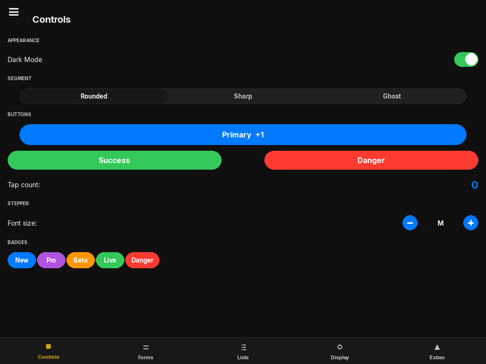
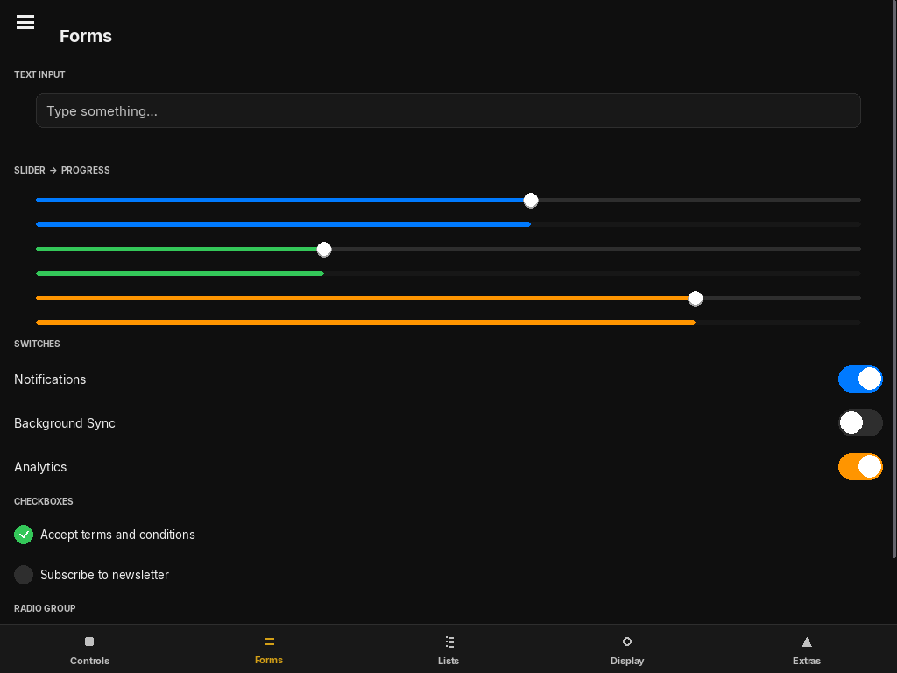
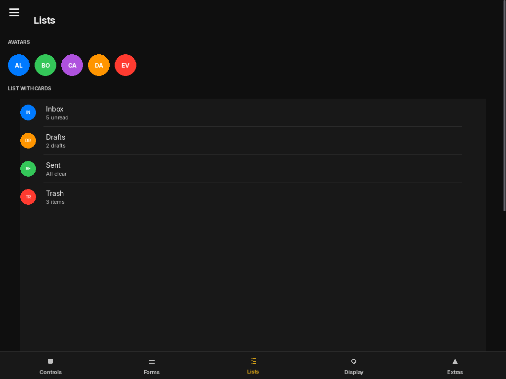
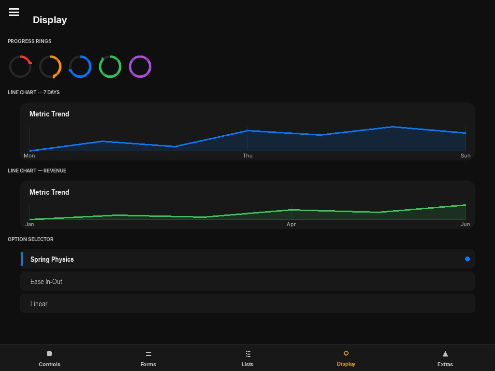
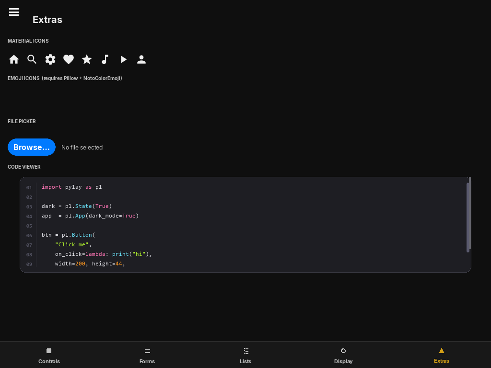

# PyLay

An iOS-inspired UI framework for [pygame](https://www.pygame.org/). PyLay provides a hierarchical widget tree, spring-based physics animations, reactive state management, and a complete dark/light theming system — built entirely on top of pygame with no external UI toolkit.

Used inside [Pianove](../README.md) and independently usable in any pygame application.



## Installation

```bash
pip install pylay
```

Requires **Python ≥ 3.10** and **pygame** (`Pillow` is optional, used for image loading).

## Quick start

```python
from pylay import App, VStack, Button, Label, Switch, State

class DemoApp(App):
    def build(self):
        toggled = State(False)
        return VStack([
            Label("Hello from PyLay"),
            Switch(value=toggled),
            Button("Tap me", on_tap=lambda: print("tapped")),
        ])

DemoApp().run()
```

## Widgets

| Category | Widgets |
|----------|---------|
| Controls | `Button`, `Switch`, `Slider`, `TextField`, `Checkbox`, `RadioButton`, `SegmentedControl`, `Stepper` |
| Display | `Label`, `Badge`, `Avatar`, `ProgressBar`, `ProgressRing`, `LineChart`, `CodeViewer` |
| Lists | `ListItem`, `Divider`, `SlideReveal`, `EmptyState` |
| Navigation | `BottomNav`, `SideNav`, `HamburgerButton`, `SidebarDrawer`, `PageRouter` |
| Advanced | `PygameCanvas`, `ScrollableCanvas`, `FilePicker`, `OptionSelector`, `Icon`, `EmojiIcon` |

29 widgets total.

## Layouts

```python
from pylay import VStack, HStack, FloatLayout, PageRouter, SidebarDrawer

# vertical stack with optional scrolling
VStack([widget_a, widget_b], spacing=12)

# horizontal stack
HStack([left, right], spacing=8)

# absolute-position container
FloatLayout([widget], constraints={"x": 20, "y": 20})

# animated page transitions
router = PageRouter(routes={"home": HomePage, "detail": DetailPage})
router.push("detail")
```

## State and animations

`State` is a reactive value — widgets bound to it re-render automatically when it changes. Animations run on a spring solver (no fixed duration, always feels snappy).

```python
count = State(0)
label = Label(count)          # updates whenever count changes
count.set(count.get() + 1)    # triggers re-render
```

## Theming

PyLay ships with an iOS colour palette and automatic dark/light mode switching.

```python
from pylay import Theme, ColorPalette

Theme.set_mode("dark")        # "light" | "dark" | "auto"
```

## Scaling

```python
from pylay import scaled_px, UI_SCALE

UI_SCALE = 1.5                # set before App.run()
size = scaled_px(44)          # returns 66
```

## Storage

Persistent JSON key-value store backed by a local file:

```python
from pylay import Storage

Storage.set("volume", 0.8)
vol = Storage.get("volume", default=1.0)
```

## Screenshots

| Controls | Forms | Lists |
|----------|-------|-------|
|  |  |  |

| Display | Extras |
|---------|--------|
|  |  |

## API reference

Full documentation: [`docs/pylay.html`](../docs/pylay.html)

## License

GNU General Public License v3.0 — see [`LICENSE`](../LICENSE).
