<div align="center">

# Pianove

**Free, open-source piano learning: no account, no subscription, entirely offline.**

Lessons that explain with animated hands · any MusicXML piece turned into a step-by-step learning path · a MIDI keyboard, an acoustic piano through the microphone, or just your computer keyboard

**[⬇ Download for Windows, macOS and Linux](https://github.com/MariusAngermann08/Pianove/releases)**

[Website](https://mariusangermann08.github.io/Pianove/) ·
[User Guide](https://mariusangermann08.github.io/Pianove/docs.html) ·
[Quick Start](https://mariusangermann08.github.io/Pianove/docs/quickstart.html) ·
[PyLute API](https://mariusangermann08.github.io/Pianove/pylute.html) ·
[PyLay API](https://mariusangermann08.github.io/Pianove/pylay.html)


</div>

Pianove is built in Python on pygame, together with two libraries of its own, for the [FSFE Youth Hacking for Freedom 2026](https://fsfe.org/activities/yh4f/) competition.

## Highlights

<table>
<tr>
<td width="50%" valign="top">

### Lessons that explain, then let you play
24 lessons in three courses. Each starts with a short animated scene (text, keyboard, staff and a hand that shows how it is played), then you play the piece from the staff, section by section, up to a run in tempo. Afterwards you see how many notes were on time and how it compares with last time, and you can listen to your take or save it as audio.

</td>
<td width="50%"></td>
</tr>
<tr>
<td>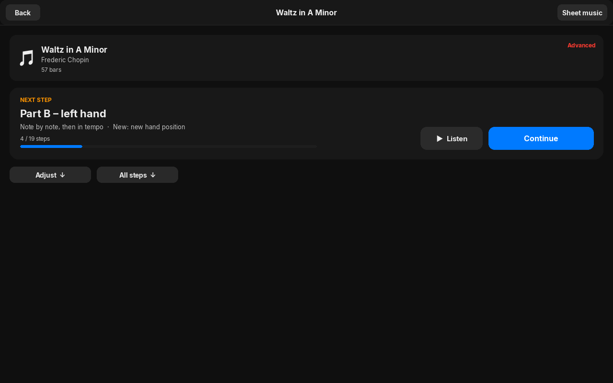</td>
<td valign="top">

### Any piece, as a learning path
Twelve public-domain pieces come with the app, from *Mary Had a Little Lamb* to Pachelbel's *Canon*; import any MusicXML file for more. Pianove cuts a piece into parts, names what is new in each (chords, leaps, black keys, hands together) and takes you through right hand, left hand and both, up to the whole piece, with up to three stars per step. While you learn one hand, Pianove plays the other, so you always hear the whole piece. Slow it down, switch on the metronome, or loop the bars you're stuck on.

</td>
</tr>
<tr>
<td valign="top">

### Hands and fingering
Animated hands show which finger plays every note. The fingering is computed for each passage with the ergonomic rules piano teachers use.

</td>
<td></td>
</tr>
<tr>
<td></td>
<td valign="top">

### Creator Mode
Write your own lessons and courses in the app, with a live preview, a score editor, MusicXML import and translations, and share them as a single `.pianove-pkg` file.

</td>
</tr>
</table>

## Features

- **Today's session:** one tap on Home starts a short plan made from where you are: a sight-reading warm-up, your next lesson, the next step of your song
- **24 built-in lessons** in three courses (*Beginner Path*, *Melody Explorer*, *Both Hands Together*), in English and German; the setup asks how much you've played and suggests where to start
- **12 songs to start with**, arranged for both hands; **import** any MusicXML file (`.musicxml`, `.xml`, `.mxl`), read the full score, and learn it on a **learning path** or in free practice: one hand or both, any range of bars, 50–100 % tempo, with a metronome; Pianove plays the hand you're not practising
- **Feedback after every run in tempo:** notes on time, early or late, the change since last time, and your take to listen to or save as a WAV file
- **Sight-reading practice:** endless generated exercises by clef, key, level and tempo
- **Play on anything**, chosen in one place (*Settings → Your Instrument*): a USB MIDI keyboard (found and calibrated automatically), an acoustic piano through the microphone *(beta, local numpy note detector)*, or the computer keyboard and mouse
- **Animated hands with automatic fingering** in lessons and songs
- **Honest progress:** practice time measured from what you play, a daily goal in minutes, streaks that count lessons, songs and sight-reading, the last 7 days as a chart, achievements
- **Built-in grand piano sound** (FluidSynth + Salamander C5 SoundFont); without it Pianove runs silently and says why
- **Creator Mode:** lesson editor, course editor, packages to share
- Dark and light mode (the score included), everything stored locally in `~/.pianove/`

## Quick start

**Ready-made app:** download it from the [Releases page](https://github.com/MariusAngermann08/Pianove/releases) (Windows `.zip`, macOS `.zip`, Linux `.tar.gz`), unpack and start *Pianove*. No Python needed.

**From source:**

```bash
git clone https://github.com/MariusAngermann08/Pianove.git
cd Pianove
pip install -r requirements.txt
python main.py
```

The piano sound needs the native **FluidSynth** library. It ships for Windows in `bin/`; elsewhere install it first (without it Pianove runs, silently):

| macOS | Debian / Ubuntu | Fedora | Arch |
|---|---|---|---|
| `brew install fluid-synth` | `sudo apt install libfluidsynth3` | `sudo dnf install fluidsynth-libs` | `sudo pacman -S fluidsynth` |

No keyboard? Choose *Use the microphone* during setup for an acoustic piano, or simply play with your computer keys: <kbd>A</kbd>–<kbd>L</kbd> are the white keys, <kbd>W</kbd> <kbd>E</kbd> <kbd>T</kbd> <kbd>Y</kbd> <kbd>U</kbd> the black ones, <kbd>Z</kbd>/<kbd>X</kbd> change the octave. The full walkthrough is in the [Installation guide](https://mariusangermann08.github.io/Pianove/docs/installation.html).

## Screenshots

| Home | Lessons | Songs |
|---|---|---|
| 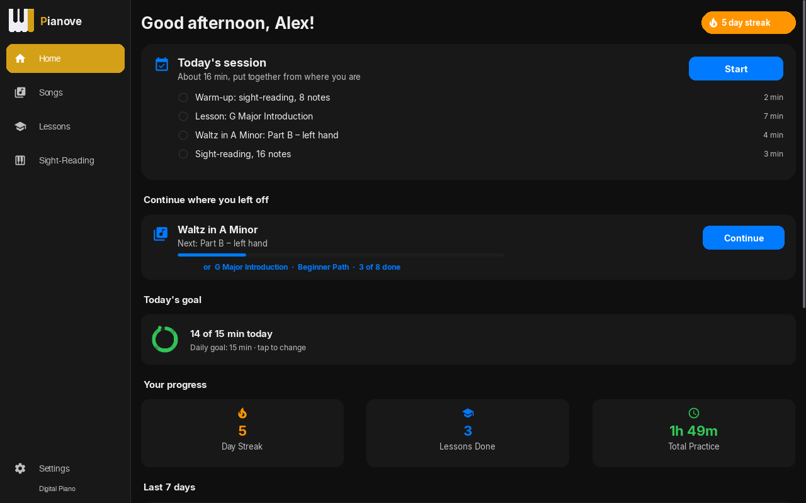 | 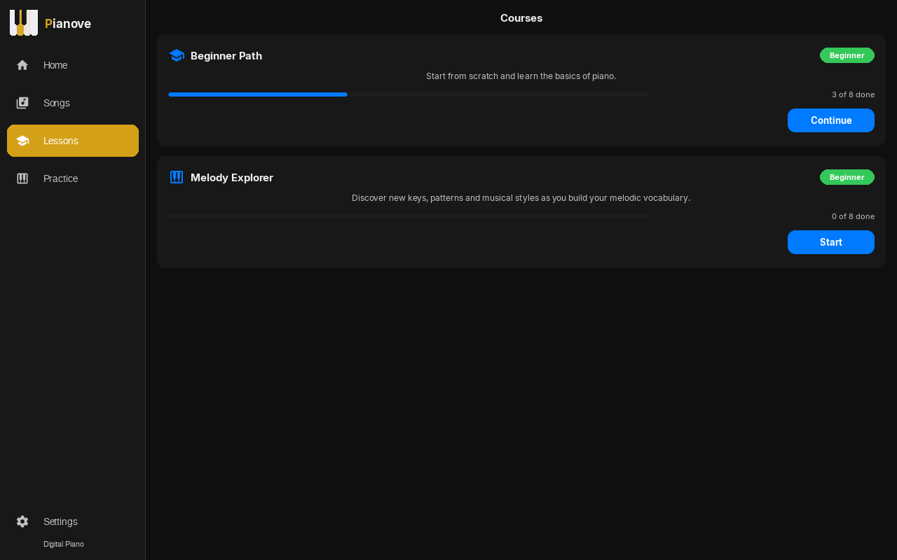 |  |
| **A song, adjusted** | **Score viewer** | **Sight-reading** |
| 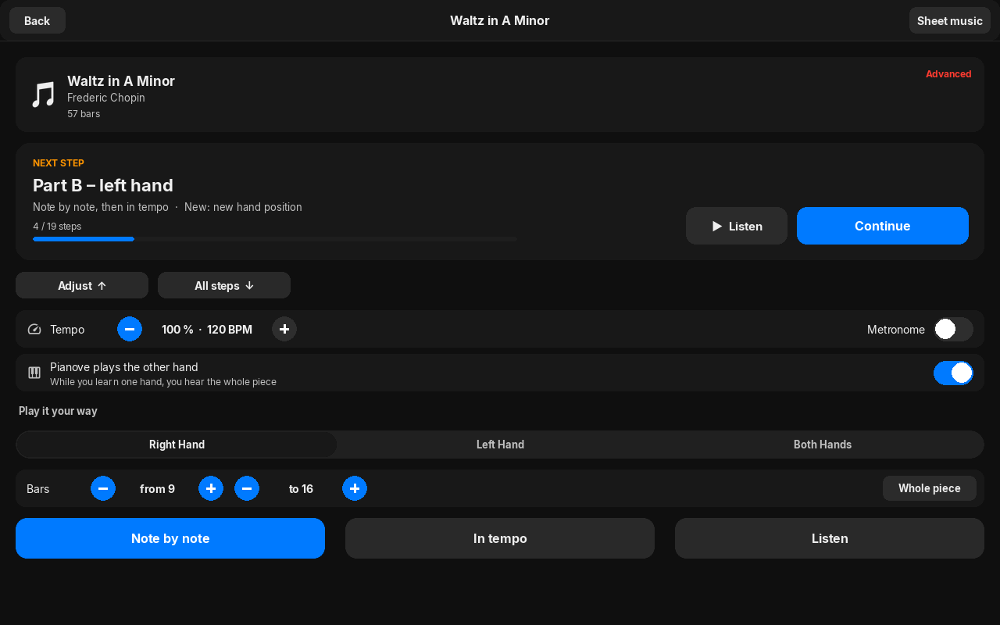 | 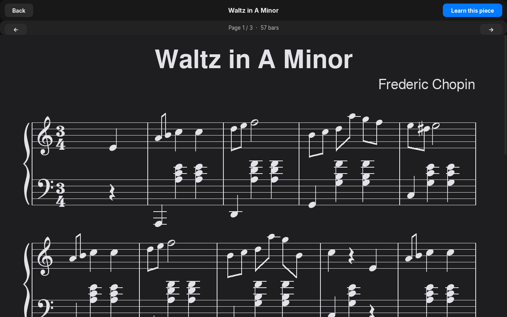 | 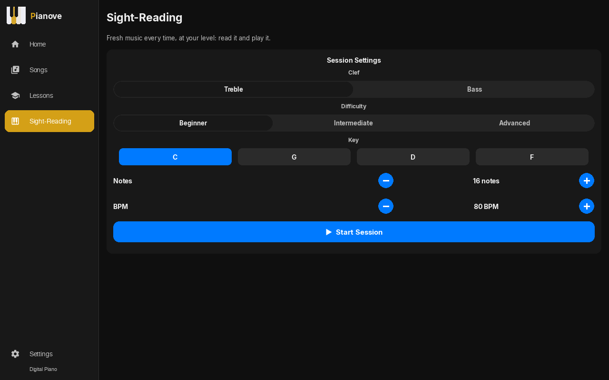 |
| **Settings** | **Your instrument** | **Course** |
| 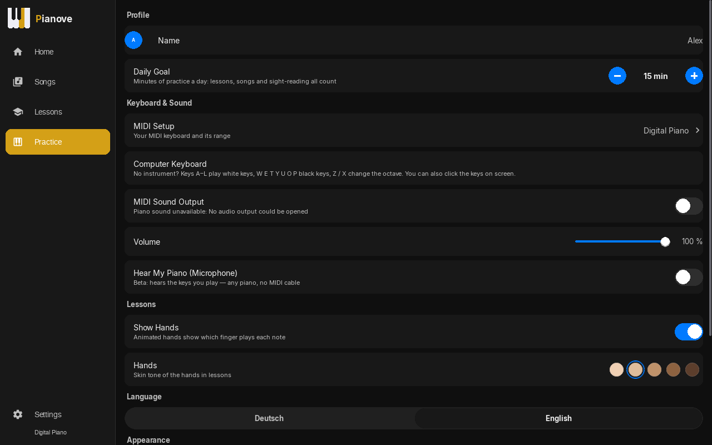 | 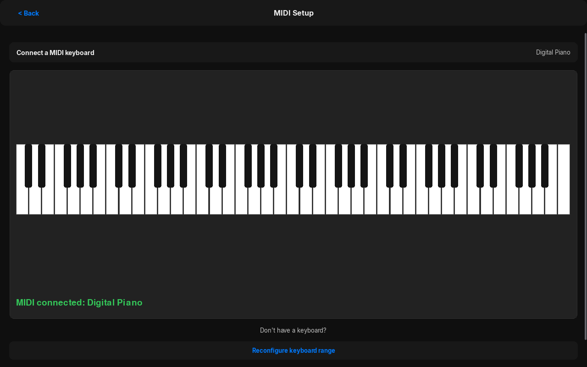 | 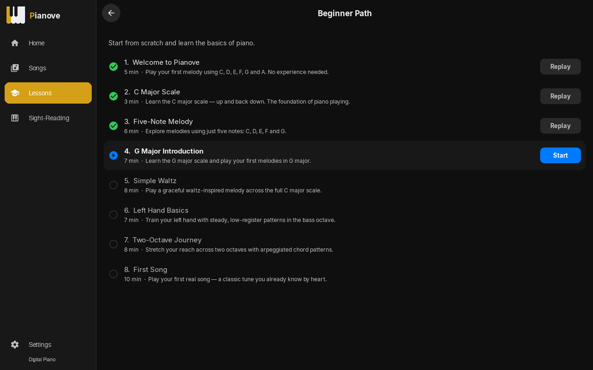 |
| **After a run in tempo** | **Before the run in tempo** | **First-start setup** |
| 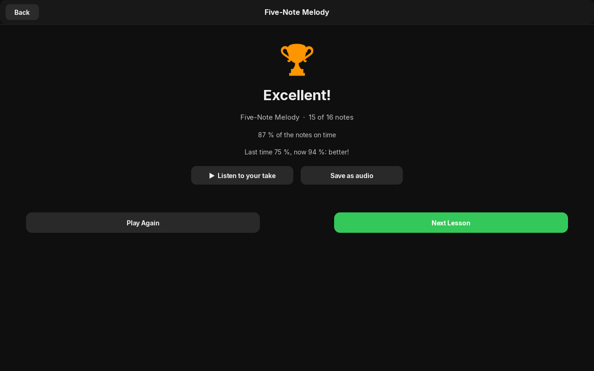 | 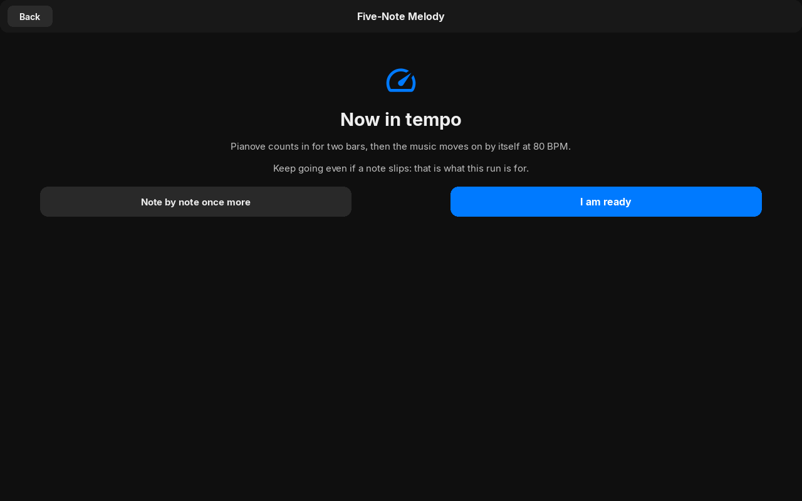 | 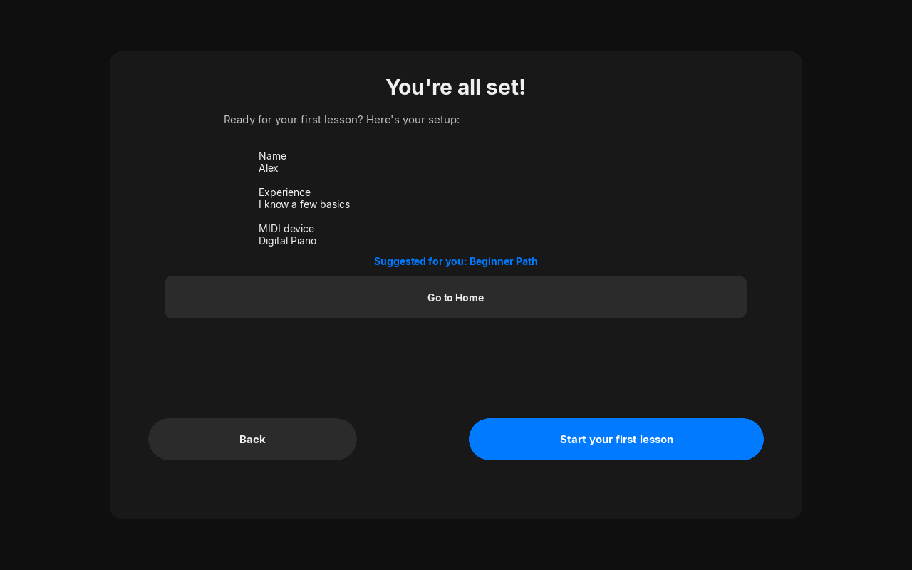 |
| **Light mode** | **Setup: your keyboard** | **Creator Mode** |
| 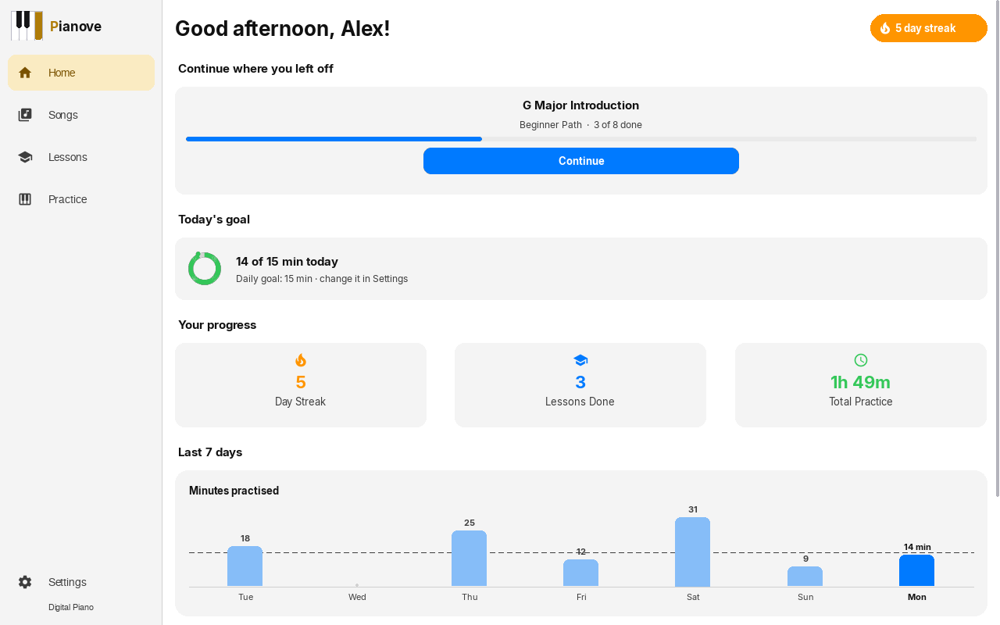 | 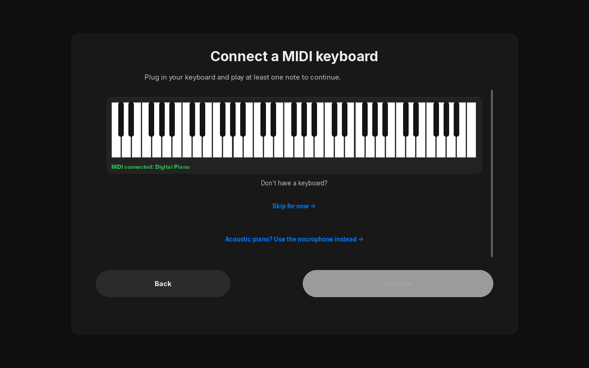 |  |

## What's inside

| Project | Type | Description |
|---------|------|-------------|
| **Pianove** | Application | The app: lessons, songs and learning paths, MIDI and microphone input, built-in synthesiser, editors |
| **PyLute** | Library (`PyLute/`) | Music notation renderer on pygame with the Bravura SMuFL font |
| **PyLay** | Library (`PyLay/`) | iOS-inspired pygame UI framework: 30 widgets, spring animations, theming |

PyLute and PyLay are independent libraries; Pianove uses both.

```
Pianove/
├── main.py                 entry point
├── pianove/                the application
│   ├── pages/              full-screen pages: onboarding, lesson player, theory scenes, editors
│   ├── home/               the tabs: Home, Songs, Lessons, Sight-Reading, Create, Settings
│   ├── lessons/ courses/   built-in content (JSON, see LESSON_FORMAT.md)
│   ├── assets/songs/       the songs that come with the app (MusicXML)
│   ├── audio_input/        microphone note detection
│   ├── midi/               MIDI keyboard input and the on-screen keyboard
│   ├── song_path.py        learning paths for imported songs
│   ├── session.py          today's session on Home
│   ├── recording.py        your take: listen back, save as WAV
│   ├── fingering.py        automatic fingering
│   ├── hands.py            animated hands
│   ├── progress.py         practice time, streaks, daily goal
│   ├── keyboard_input.py   the computer keyboard as a piano
│   └── metronome.py        the metronome click
├── PyLute/                 notation renderer library
├── PyLay/                  UI framework library
├── docs/                   website and user guide (static HTML)
├── scripts/                screenshots, the bundled songs, detector evaluation, piano templates
├── tests/                  pytest suite
├── pianove.spec            PyInstaller build of the stand-alone app
└── .github/workflows/      builds the apps for Windows, macOS and Linux
```

## Documentation

The website at **[mariusangermann08.github.io/Pianove](https://mariusangermann08.github.io/Pianove/)** has:

- **[User Guide](https://mariusangermann08.github.io/Pianove/docs.html)**: installation, keyboard & microphone, lessons, songs & learning path, practice, settings, Creator Mode
- **[Lesson & Course Format](https://mariusangermann08.github.io/Pianove/docs/lesson-format.html)**, also in [`LESSON_FORMAT.md`](LESSON_FORMAT.md)
- **[PyLute API reference](https://mariusangermann08.github.io/Pianove/pylute.html)** and **[PyLay API reference](https://mariusangermann08.github.io/Pianove/pylay.html)**

## Libraries

### PyLute

Renders sheet music from MusicXML files or programmatic note input onto any pygame surface. Uses the Bravura SMuFL font, bundled inside the package.

```python
import pylute
score = pylute.load_musicxml("piece.xml", surface=screen)
score.draw()
```

See [`PyLute/README.md`](PyLute/README.md).

### PyLay

An iOS-inspired UI framework for pygame: widget tree, spring-physics animations, reactive state, dark/light theming.

```python
from pylay import App, VStack, Button, Label

class MyApp(App):
    def build(self):
        return VStack([
            Label("Hello from PyLay"),
            Button("Click me", on_tap=lambda: print("tapped")),
        ])

MyApp().run()
```

See [`PyLay/README.md`](PyLay/README.md).

## Development

```bash
pip install pytest
python -m pytest tests -q                    # runs headless: no window, sound card or keyboard
python scripts/screenshot_pianove.py         # regenerate the app screenshots in docs/img/
python scripts/promo/record.py clips && python scripts/promo/compose.py clips promo.mp4   # the promo video
pip install pyinstaller && pyinstaller pianove.spec   # build the stand-alone app into dist/
```

Pushing a tag like `v1.1.0` runs `.github/workflows/build.yml`, which builds the app on Windows, macOS and Linux and attaches the three downloads to a GitHub release.

The screenshot script runs the real app off-screen with a throw-away home folder and demo data, so your own progress is never touched.

## What's next

- Publish **PyLute** and **PyLay** to PyPI
- Multiple voices on one staff, slurs and repeat barlines in PyLute
- More languages for the app and the lessons

## License

GNU General Public License v3.0. See [LICENSE](LICENSE).
