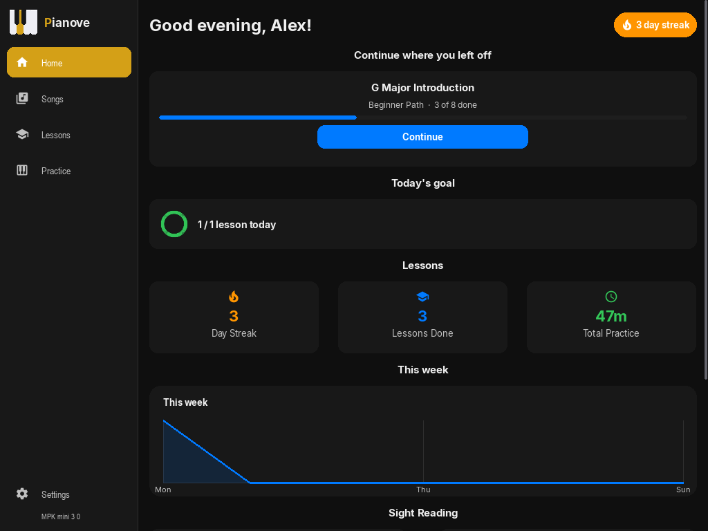
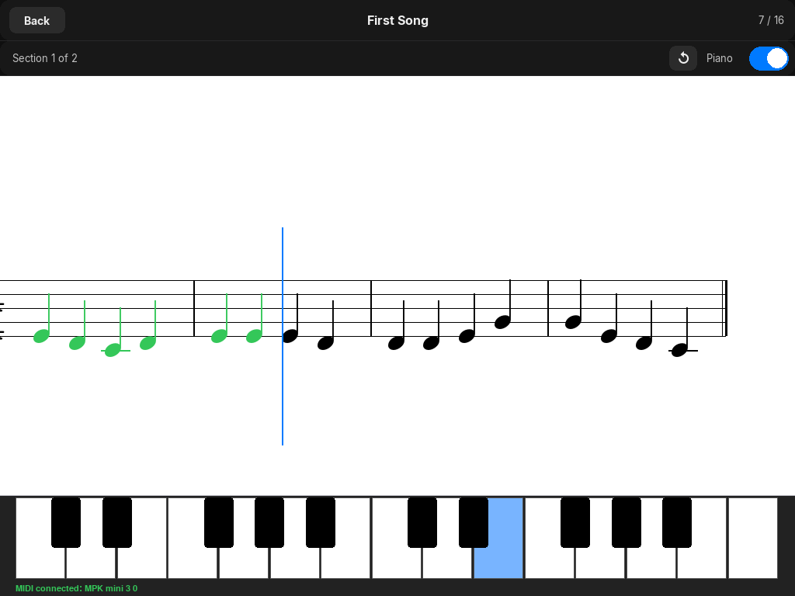
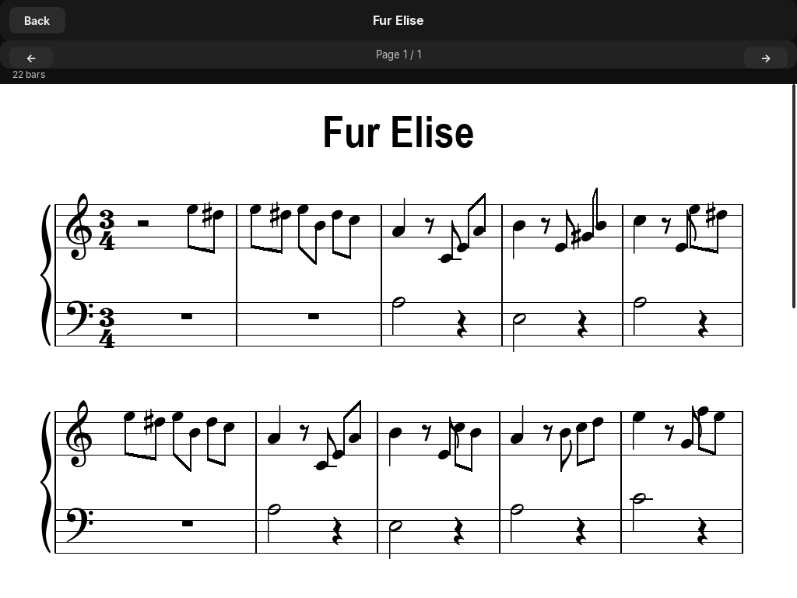

# Pianove

Free, open-source piano learning software — no account, no subscription, entirely offline.

Practice any piece from a MusicXML file on a MIDI keyboard. Built in Python on pygame as part of the [FSFE Youth Hacking for Freedom 2026](https://fsfe.org/activities/yh4f/) competition.



## What's inside

| Project | Type | Description |
|---------|------|-------------|
| **Pianove** | Application | The app itself — MIDI input, lesson system, score viewer, built-in synthesiser |
| **PyLute** | Library (`PyLute/`) | Music notation renderer built on pygame + Bravura SMuFL font |
| **PyLay** | Library (`PyLay/`) | iOS-inspired pygame UI framework — 29 widgets, spring animations, theming |

PyLute and PyLay are fully independent libraries. Pianove is the application that uses both.

## Quick start

```bash
git clone https://github.com/MariusAngermann08/Pianove.git
cd Pianove
pip install pygame
python main.py
```

A MIDI keyboard is detected automatically if connected. Without one you can still explore lessons in test mode.

## Screenshots

| Home | Lesson | Score |
|------|--------|-------|
|  |  |  |

## Features

- 16 built-in progressive lessons
- Import any MusicXML file (`.xml`, `.musicxml`, `.mxl`) and practice it immediately
- Real-time note detection from any MIDI keyboard
- Built-in software synthesiser — no external audio setup required
- Full sheet music rendering via PyLute (clefs, key signatures, beams, ties, dynamics, articulations)
- Onboarding wizard with language selection and MIDI device configuration
- Progress tracking and statistics
- Dark and light mode

## Requirements

- Python 3.10 or later
- `pygame` (`pip install pygame`)
- MIDI keyboard (optional)

## Project structure

```
Pianove/
├── main.py              # entry point
├── pianove/             # application code
├── PyLute/              # music notation renderer library
│   ├── pylute/          # package source
│   └── pyproject.toml
├── PyLay/               # pygame UI framework library
│   ├── pylay/           # package source
│   └── pyproject.toml
└── docs/                # documentation website (static HTML)
```

## Documentation

The full documentation site lives in `docs/` and is also hosted online:

- [Pianove docs](docs/docs/quickstart.html) — quick start, MIDI setup, lessons, MusicXML import
- [PyLute API reference](docs/pylute.html) — notation renderer API
- [PyLay API reference](docs/pylay.html) — UI framework API

## Libraries

### PyLute

Renders sheet music from MusicXML files or programmatic note input onto any pygame surface. Uses the Bravura SMuFL font, bundled inside the package.

```python
import pylute
score = pylute.load_musicxml("piece.xml", surface=screen)
score.draw()
```

See [`PyLute/README.md`](PyLute/README.md) for the full API.

### PyLay

An iOS-inspired UI framework for pygame — widget tree, spring-physics animations, reactive state, dark/light theming.

```python
from pylay import App, VStack, Button, Label

class MyApp(App):
    def build(self):
        return VStack([
            Label("Hello from PyLay"),
            Button("Click me", on_tap=lambda: print("tapped")),
        ])

MyApp().run()
```

See [`PyLay/README.md`](PyLay/README.md) for the full API.

## License

GNU General Public License v3.0 — see [LICENSE](LICENSE).
