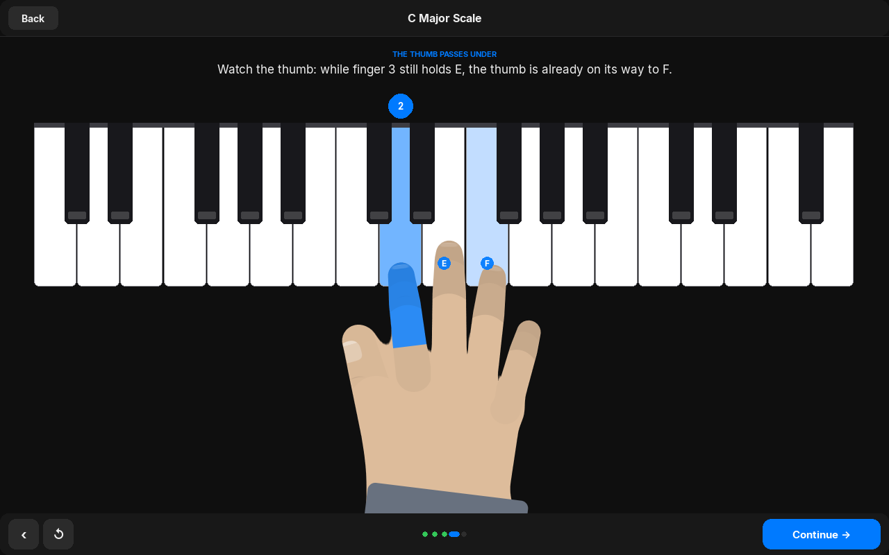
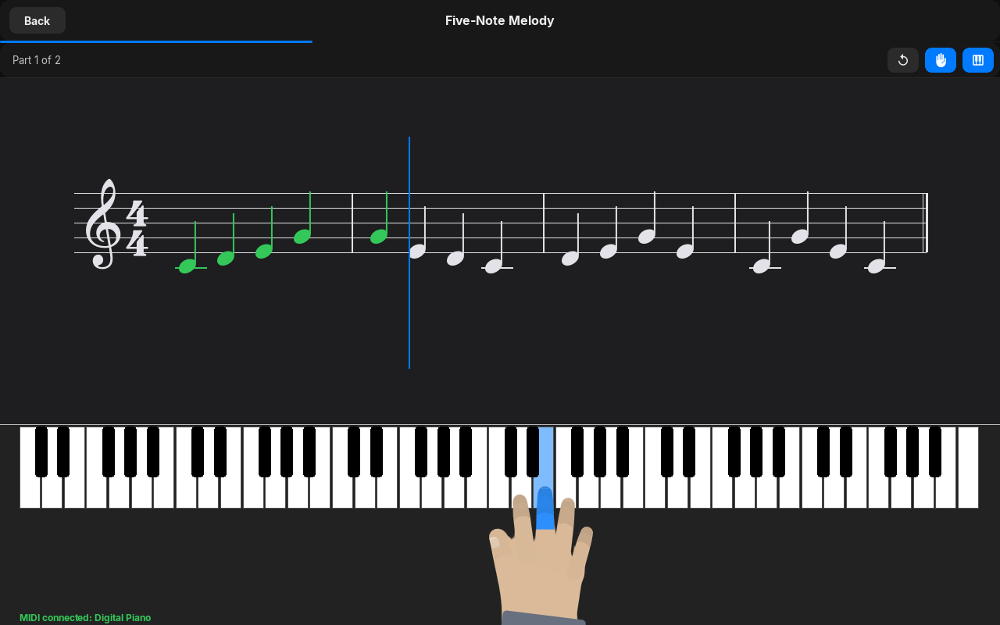
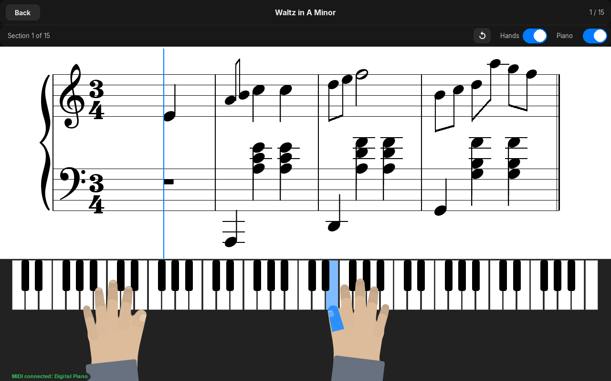
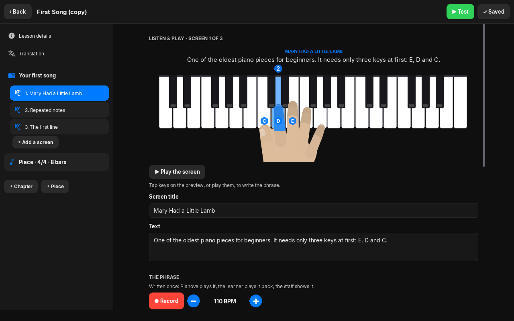
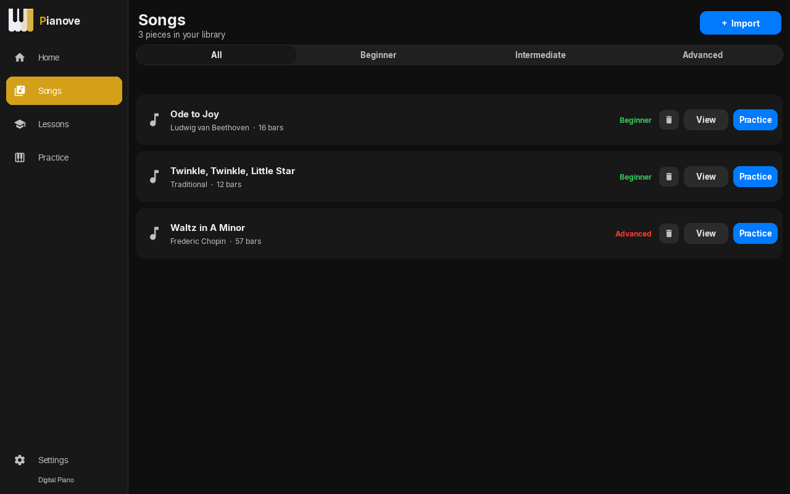
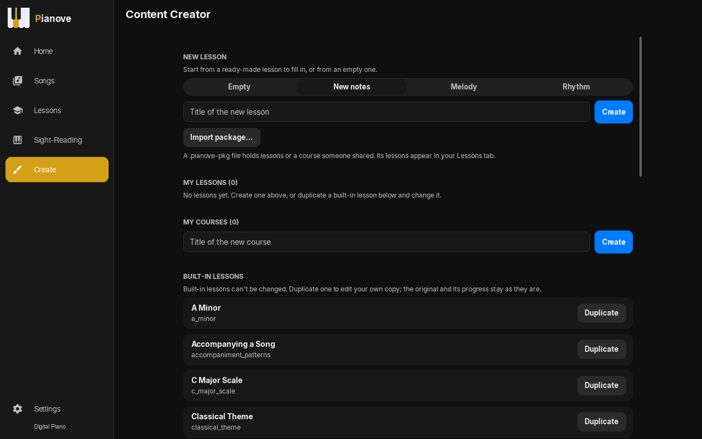

<div align="center">

# Pianove

**Free, open-source piano learning: no account, no subscription, entirely offline.**

Lessons that explain with animated hands · any MusicXML piece turned into a step-by-step learning path · a MIDI keyboard or an acoustic piano through the microphone

[Website](https://mariusangermann08.github.io/Pianove/) ·
[User Guide](https://mariusangermann08.github.io/Pianove/docs.html) ·
[Quick Start](https://mariusangermann08.github.io/Pianove/docs/quickstart.html) ·
[PyLute API](https://mariusangermann08.github.io/Pianove/pylute.html) ·
[PyLay API](https://mariusangermann08.github.io/Pianove/pylay.html)




</div>

Pianove is built in Python on pygame, together with two libraries of its own, for the [FSFE Youth Hacking for Freedom 2026](https://fsfe.org/activities/yh4f/) competition.

## Highlights

<table>
<tr>
<td width="50%" valign="top">

### Lessons that explain, then let you play
16 lessons in two courses. Each starts with a short animated scene (text, keyboard, staff and a hand that shows how it is played), then you play the piece from the staff, section by section, up to a final performance in tempo.

</td>
<td width="50%"></td>
</tr>
<tr>
<td></td>
<td valign="top">

### Any piece, as a learning path
Import a MusicXML file and Pianove cuts it into parts, names what is new in each (chords, leaps, black keys, hands together) and takes you through right hand, left hand and both, up to the whole piece, with up to three stars per step.

</td>
</tr>
<tr>
<td valign="top">

### Hands and fingering *(beta)*
Animated hands show which finger plays every note. The fingering is computed for each passage with the ergonomic rules piano teachers use.

</td>
<td></td>
</tr>
<tr>
<td></td>
<td valign="top">

### Creator Mode
Write your own lessons and courses in the app, with a live preview, a score editor, MusicXML import and translations, and share them as a single `.pianove-pkg` file.

</td>
</tr>
</table>

## Features

- **16 built-in lessons** in two courses (*Beginner Path*, *Melody Explorer*), in English and German
- **Songs:** import any MusicXML file (`.musicxml`, `.xml`, `.mxl`), read the full score, and learn it on a **learning path** or in free practice (one hand or both, waiting for you or in tempo)
- **Sight-reading practice:** endless generated exercises by clef, key, level and tempo
- **MIDI keyboards:** detected automatically, range calibrated once, reconnected when re-plugged
- **Hear My Piano** *(beta)*: play an acoustic piano through the microphone; a local, numpy-only note detector works out the keys
- **Built-in grand piano sound** (FluidSynth + Salamander C5 SoundFont) for silent keyboards and demos
- **Animated hands with automatic fingering** *(beta)*
- **Progress:** day streak, daily goal, weekly chart, achievements
- **Creator Mode:** lesson editor, course editor, packages to share
- Dark and light mode, onboarding wizard, everything stored locally in `~/.pianove/`

## Quick start

```bash
git clone https://github.com/MariusAngermann08/Pianove.git
cd Pianove
pip install -r requirements.txt
python main.py
```

The piano sound needs the native **FluidSynth** library. It ships for Windows in `bin/`; on other systems install it first:

| macOS | Debian / Ubuntu | Fedora | Arch |
|---|---|---|---|
| `brew install fluid-synth` | `sudo apt install libfluidsynth3` | `sudo dnf install fluidsynth-libs` | `sudo pacman -S fluidsynth` |

A MIDI keyboard is found automatically. No keyboard? Choose *Use the microphone instead* during setup, or turn on **Settings → Hear My Piano**. The full walkthrough is in the [Installation guide](https://mariusangermann08.github.io/Pianove/docs/installation.html).

## Screenshots

| Home | Lessons | Songs |
|---|---|---|
|  |  |  |
| **Score viewer** | **Sight-reading practice** | **Settings** |
|  |  |  |
| **Light mode** | **Setup** | **Creator Mode** |
|  |  |  |

## What's inside

| Project | Type | Description |
|---------|------|-------------|
| **Pianove** | Application | The app: lessons, songs and learning paths, MIDI and microphone input, built-in synthesiser, editors |
| **PyLute** | Library (`PyLute/`) | Music notation renderer on pygame with the Bravura SMuFL font |
| **PyLay** | Library (`PyLay/`) | iOS-inspired pygame UI framework: 29 widgets, spring animations, theming |

PyLute and PyLay are independent libraries; Pianove uses both.

```
Pianove/
├── main.py                 entry point
├── pianove/                the application
│   ├── pages/              full-screen pages: onboarding, lesson player, theory scenes, editors
│   ├── home/               the tabs: Home, Songs, Lessons, Practice, Create, Settings
│   ├── lessons/ courses/   built-in content (JSON, see LESSON_FORMAT.md)
│   ├── audio_input/        microphone note detection
│   ├── midi/               MIDI keyboard input and the on-screen keyboard
│   ├── song_path.py        learning paths for imported songs
│   ├── fingering.py        automatic fingering
│   └── hands.py            animated hands
├── PyLute/                 notation renderer library
├── PyLay/                  UI framework library
├── docs/                   website and user guide (static HTML)
├── scripts/                screenshots, detector evaluation, piano templates
└── tests/                  pytest suite
```

## Documentation

The website at **[mariusangermann08.github.io/Pianove](https://mariusangermann08.github.io/Pianove/)** has:

- **[User Guide](https://mariusangermann08.github.io/Pianove/docs.html)**: installation, keyboard & microphone, lessons, songs & learning path, practice, settings, Creator Mode
- **[Lesson & Course Format](https://mariusangermann08.github.io/Pianove/docs/lesson-format.html)**, also in [`LESSON_FORMAT.md`](LESSON_FORMAT.md)
- **[PyLute API reference](https://mariusangermann08.github.io/Pianove/pylute.html)** and **[PyLay API reference](https://mariusangermann08.github.io/Pianove/pylay.html)**

## Libraries

### PyLute

Renders sheet music from MusicXML files or programmatic note input onto any pygame surface. Uses the Bravura SMuFL font, bundled inside the package.

```python
import pylute
score = pylute.load_musicxml("piece.xml", surface=screen)
score.draw()
```

See [`PyLute/README.md`](PyLute/README.md).

### PyLay

An iOS-inspired UI framework for pygame: widget tree, spring-physics animations, reactive state, dark/light theming.

```python
from pylay import App, VStack, Button, Label

class MyApp(App):
    def build(self):
        return VStack([
            Label("Hello from PyLay"),
            Button("Click me", on_tap=lambda: print("tapped")),
        ])

MyApp().run()
```

See [`PyLay/README.md`](PyLay/README.md).

## Development

```bash
pip install pytest
python -m pytest tests -q                    # runs headless: no window, sound card or keyboard
python scripts/screenshot_pianove.py         # regenerate the app screenshots in docs/img/
```

The screenshot script runs the real app off-screen with a throw-away home folder and demo data, so your own progress is never touched.

## What's next

- Publish **PyLute** and **PyLay** to PyPI
- Multiple voices on one staff, slurs and repeat barlines in PyLute
- More languages for the app and the lessons

## License

GNU General Public License v3.0. See [LICENSE](LICENSE).
